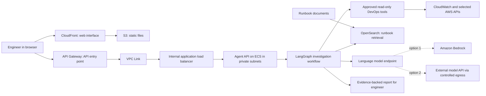
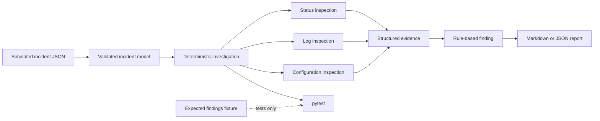

# Agentic DevOps Lab

Hi, I’m Bhari. In this lab, we’ll take a familiar DevOps problem and build an incident investigator around it, one step at a time.

The first incident is simple: an `orders-api` container keeps restarting. We have its status, startup logs, and a list of required environment variables. We’ll inspect that evidence and produce a report that explains what failed and what to check next.

Everything in Day 1 is simulated. The example does not connect to Docker, AWS, an AI model, or any external service. You can run it on your laptop without cloud credentials or a model API key.

## First, see the whole picture

Before we build anything, let’s understand where this small lab can lead. An engineer reports an incident. An agent workflow gathers evidence using approved tools, looks up relevant runbook notes, and prepares a diagnosis for the engineer to review.

In a real AWS deployment, a browser could load the interface through CloudFront. The request could pass through API Gateway and a private load-balancer connection to an agent service running in private subnets. That service could use LangGraph to manage the investigation, OpenSearch to retrieve runbook passages, and a language model to help interpret evidence. The model might be hosted by Amazon Bedrock or reached through a carefully controlled connection to another provider.



Here is what those pieces do in plain language:

- **LangGraph** coordinates the investigation steps: what to inspect, what to do with the results, and when to stop. It is the workflow, not the language model.
- **RAG** means the system searches selected runbooks for useful passages and gives those passages to the model with the incident evidence. OpenSearch can store and retrieve those passages. It does not train the model.
- **Model choice** depends on the job, quality, response time, privacy, cost, and available provider. A generative model helps interpret evidence; a separate embedding model may turn runbook text and questions into vectors for semantic search.
- **CloudFront, API Gateway, VPC Link, the load balancer, and ECS** are possible ways to deliver and run the service on AWS. They do not make the agent intelligent by themselves.

This is our destination map, not what Day 1 deploys. We’ll explain each concept as it becomes useful. The Day 1 hands-on version runs locally: incident fixture → three inspection functions → known rule → report. LangGraph comes on Day 4, runbook retrieval on Day 5, and optional AWS checks on Day 7.

## Day 1: investigate the incident

The app exits because the required `DATABASE_URL` variable is missing. The investigator finds that from the log and configuration evidence, then includes both in its report. The expected answer is kept in a separate file for tests; the investigation code never sees it.

We’ll use this result as our starting point for the later lessons. First, we need a clear example of the evidence and outcome we expect.

## Chatbot, script, or agent?

- A **chatbot** answers a question. Ask it what a container restart means, and it can explain the concept.
- A **script** follows steps we wrote in advance. If a condition is true, it runs the matching check.
- An **agent** uses a model to choose from tools we allow, reads each result, and decides whether to gather more evidence or write its report. Our application still validates every tool request before it runs.

Day 1 is the script. Later lessons will add the agent behavior.

## How the project is organized

- [Architecture and data flow](docs/architecture.md)
- [Day 1–10 learning roadmap](docs/learning-roadmap.md)
- [Agentic DevOps concept notes](agentic-devops-notes/README.md)
- [Security model](docs/security-model.md)
- [Simulated incident](scenarios/container-restart/incident.json)
- [Expected findings used by tests](scenarios/container-restart/expected-findings.json)



## What you need

- Python 3.10 or newer
- `pip`
- `pytest` for the tests

No Docker installation, AWS account, API key, or cloud service is needed.

## Install and run

Open a terminal in this folder:

```powershell
python -m venv .venv
.venv\Scripts\Activate.ps1
python -m pip install -e ".[dev]"
python examples/investigate_incident.py
```

To print JSON, or to try a different incident fixture:

```powershell
python examples/investigate_incident.py --format json
python examples/investigate_incident.py --incident scenarios/container-restart/incident.json --format markdown
```

The command returns exit code `2` when an incident file is invalid or cannot be read.

## Run the tests

```powershell
python -m pytest
```

The tests check the input data, missing evidence, the diagnosis, evidence in the report, and secret redaction. They also check that shell commands and HTML-looking strings stay inert. GitHub Actions runs the same tests on Python 3.10–3.13.

## Keep the examples safe

All logs and findings are made up for this lesson. Don’t add production logs, customer data, credentials, or real secrets to the fixtures. The investigator reads variable names only; it never reads their values. Its suggested fix is text only—it doesn’t change a container or any infrastructure.

The full learning sequence is in [docs/learning-roadmap.md](docs/learning-roadmap.md). Each lesson will add one piece to this same incident investigation.
