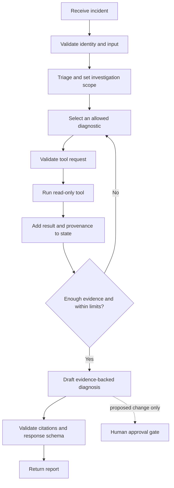

# 2. LangGraph: orchestrating an investigation

## What is LangGraph?

LangGraph is a framework for building stateful, multi-step agent and workflow applications. A graph is made from **nodes** (units of work) and **edges** (the possible transitions between them). A shared state object carries selected information through the graph. LangGraph is orchestration; it is not an LLM, a vector database, or an AWS service.

We use it when the flow has meaningful branching, state, pause/resume, or recovery requirements. A simple one-shot prompt may not need a graph framework.

## Incident workflow

The approval node is relevant only if a later version can request a change. A report-only Day 1 flow ends without it.

## Main concepts

**Node.** A function or runnable that reads part of state and returns updates. Examples: `triage`, `inspect_events`, `retrieve_runbook`, and `format_report`. Keep nodes focused so their input, output, errors, and permissions are clear.

**Edge and conditional routing.** An edge sends control to a next node. A conditional edge chooses from a finite set of destinations, such as “collect another diagnostic,” “report,” or “stop because a limit was reached.” The route must not grant permissions by itself; the called tool enforces its own authorization.

**Shared state.** A typed record can hold an investigation ID, scope, evidence items with source and timestamp, tool-call count, current hypothesis, and final report. Avoid putting credentials or unnecessary raw logs in state. Define redaction and retention because checkpointing can persist state.

**Loops and limits.** An investigation loop can ask for more evidence after seeing a result. Bound it by step count, wall-clock deadline, token/tool budgets, and an explicit terminal condition. Also detect duplicate calls or repeated failures. A cycle without a stop rule can become an expensive infinite loop.

**Checkpoint and persistence.** A checkpointer saves graph state so work may continue after interruption or resume later. Use a stable thread/investigation identifier and protect persisted data as sensitive. Checkpointing is optional for a short stateless request; it is useful for long-running work and human handoffs.

**Retry and recovery.** Retry transient faults only when the operation is safe to repeat. Use bounded exponential backoff with jitter where appropriate, and distinguish transient provider/network errors from invalid inputs and permission denials. Idempotency keys help avoid duplicate effects, but read-only tools remain preferable.

**Human approval.** An interrupt can pause a graph until a person reviews a specific proposed action. The approval must bind to the exact action and current evidence, expire, and be checked again at execution. A model saying “approved” is not approval.

## Example state and tool contract

An evidence item should identify `tool_name`, a sanitized result, observation time, and source resource. The model can request a tool by structured name and arguments. The application validates type, allowed resource scope, and limits before execution; the tool returns a typed result or a safe error. The model never supplies the implementation or raw command.

For example, the initial state could contain `incident_id`, `environment`, `deployment_id`, and `steps_used: 0`. The status node adds an evidence record with deployment state `FAILED` and source `ECS service events`. The router sees that logs are still needed and selects `read_task_logs`. Once the logs show a missing configuration reference, the next route may retrieve the matching runbook and create the report. The state stores the *fact and its source*, not a hidden chain of private model reasoning.

An example tool request might be `{ "name": "read_task_logs", "arguments": { "service": "orders-api", "task_id": "task-42" } }`. The service checks that `orders-api` is in the caller’s allowed scope, applies a time range and byte limit, redacts sensitive values, and returns structured log evidence. If the model asks for a different account or an unsupported argument, validation rejects it before AWS is called.

### Why explicit routing helps

If the incident has a known validation error, code can route straight to a configuration check. If the failure is unclear, a model can choose between a small set of diagnostic tools. This is a **hybrid workflow**: fixed edges enforce policy and ordering; conditional edges handle evidence-dependent choices. It is easier to reason about than asking one model call to invent and execute an entire troubleshooting process.

## Trade-offs and safety

LangGraph provides explicit control flow and persistence options, but introduces framework and state-management concepts. A direct function or ordinary workflow engine may be simpler for a short fixed process. Graph state, prompts, retrieved text, and tool outputs are all potential prompt-injection paths. Treat them as data, keep tool access outside model control, and test routing as well as final answers.

## Interview questions

**What are nodes and edges?** Nodes perform steps; edges define the transitions. Conditional edges select a route based on validated state.

**Why use a graph instead of one long prompt?** It makes steps, branches, and stop conditions explicit, and can support persistence and interruption for workflows that need them.

**What does a checkpoint contain?** Whatever state the application persists. That may include sensitive incident evidence, so storage, access, retention, and redaction matter.

## Official references

- [LangGraph overview](https://docs.langchain.com/oss/python/langgraph/overview)
- [Graph API](https://docs.langchain.com/oss/python/langgraph/graph-api)
- [Persistence](https://docs.langchain.com/oss/python/langgraph/persistence)
- [Interrupts and human-in-the-loop](https://docs.langchain.com/oss/python/langgraph/interrupts)
- [Fault tolerance](https://docs.langchain.com/oss/python/langgraph/fault-tolerance)
