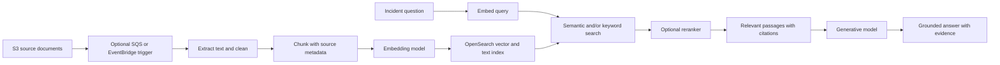

# 3. RAG: give the model relevant runbooks

## What is RAG?

Retrieval-augmented generation (RAG) retrieves selected external information and supplies it to a generative model as context for an answer. The model's training is not changed. For our incident assistant, retrieval can find the approved runbook section for a failed deployment and the answer can cite its document and section.

RAG is useful when answers depend on private, changing, or domain-specific material. It does not guarantee correctness: a bad document, poor retrieval, missing access filter, or unsupported model conclusion can still produce a bad response. For a few short stable rules, a direct lookup or deterministic code may be simpler.

## Ingestion and query flow

SQS is useful when ingestion should be buffered and retried as jobs; EventBridge is useful for routing events to consumers. Neither is required for a small, manually run batch job. Amazon Bedrock Knowledge Bases can manage parts of ingestion and retrieval; a custom pipeline gives more control and more operational work.

## How retrieval works

1. **Ingest and parse:** collect approved source files and extract text while preserving useful structure such as headings, page, source path, revision, and access label.
2. **Clean and chunk:** remove irrelevant navigation/boilerplate and split text into passages. Chunks that are too large dilute relevance; chunks that are too small lose context. Keep a link to the parent document and use overlap only when it helps preserve boundaries.
3. **Attach metadata:** store source, section, version, effective date, product, environment, and access scope. Metadata supports filtering and citations; ACLs must be enforced by the application and index design.
4. **Embed:** an embedding model maps each chunk to a numeric vector. At query time, use a compatible embedding model and the same vector dimension/configuration.
5. **Retrieve:** semantic search finds vectors near the query meaning. Keyword search matches exact terms such as error codes and resource IDs. Hybrid search combines both because DevOps queries often contain both concepts and exact identifiers.
6. **Rerank (optional):** a second scoring step reorders a larger candidate set for relevance. It can improve ordering but adds latency and cost.
7. **Ground the response:** provide selected passages, identifiers, and instructions to cite evidence and state when it is insufficient. Validate cited source IDs against the retrieved set.

### Example from a failed rollout

An engineer asks, “Why did revision 42 fail after the image change?” The query contains an exact revision number and an ambiguous symptom. Keyword search can find `revision 42` or an error code; semantic search can find a runbook titled “Container fails its startup probe” even if the question uses different wording. Hybrid retrieval returns candidate passages. A filter limits results to the engineer’s team and the current, approved runbook version. A reranker may move the passage specifically about startup probes above a general deployment guide. The model then receives the question, sanitized deployment evidence, and the selected passages with source IDs. If none explains the observed evidence, the correct answer is “The retrieved material does not establish a cause,” not a confident guess.

### What metadata does for us

For one chunk, useful fields might include `document_id=container-startup`, `section=Probe failures`, `revision=7`, `environment=all`, `team=platform`, and `effective_date`. The text says what to inspect; the metadata says which source/version it came from and who may retrieve it. A metadata filter is part of access control, so a query must not first retrieve another team’s document and rely on the model to hide it.

### Chunk-size example

If a runbook section explains a readiness probe using three related paragraphs, indexing each sentence separately can remove necessary context. Indexing the entire 80-page operations manual creates large, noisy results. A practical starting point is to split around headings and coherent procedures, then measure retrieval on real questions. There is no universally correct token count; tune it against labeled queries and the embedding/model limits.

## Retrieval evaluation

Build a small labeled question set with expected source documents and answer facts. Track whether a relevant source appears in top-k results (recall), whether returned passages are useful (precision/relevance), citation correctness, answer support, and abstention when no source applies. Evaluate ingestion separately: a missing or stale chunk cannot be repaired by changing the prompt. Avoid fabricated accuracy claims; report measured results only after running a defined dataset.

For example, write ten sanitized questions and mark the expected runbook section for each. If a relevant section appears in the top five results for eight questions, recall@5 is 8/10 for that small set. This does not mean the full production system is “80% accurate”; it measures one retrieval condition on one dataset. Keep retrieval scoring separate from whether the final generated diagnosis is correct.

## RAG compared with fine-tuning

RAG makes current selected content available at request time and can expose source references; its quality depends on ingestion and retrieval. Fine-tuning updates model behavior or task patterns using training examples; it is not a dependable way to keep a changing runbook database current. They can be combined for different needs, but neither replaces authorization or evaluation. Use RAG for knowledge that must be updated or cited; consider fine-tuning only for a measured behavior/style gap with suitable training governance.

## Security and trade-offs

Documents are untrusted input. A malicious runbook can contain prompt-injection instructions. The model must not be allowed to obey retrieved directions that override system policy or expand tool access. Apply identity-aware document filters before returning passages, prevent cross-tenant retrieval, protect source and vector data, and keep provenance. Embeddings can reveal semantic information; handle them under the same data classification policy as the source.

## Interview questions

**Does RAG train the LLM?** No. It retrieves content and puts selected context into the request.

**Why combine keyword and vector search?** Vector search helps with meaning; keyword search is strong for exact error strings, names, and IDs. A hybrid method can cover both.

**Why can a RAG answer be wrong?** The content may be stale or absent, retrieval may select irrelevant passages, metadata filters may fail, or the generator may make unsupported claims.

## Official references

- [AWS Prescriptive Guidance: choosing a RAG option](https://docs.aws.amazon.com/prescriptive-guidance/latest/retrieval-augmented-generation-options/choosing-option.html)
- [AWS Prescriptive Guidance: RAG retrievers](https://docs.aws.amazon.com/prescriptive-guidance/latest/retrieval-augmented-generation-options/rag-custom-retrievers.html)
- [Amazon Bedrock Knowledge Bases](https://docs.aws.amazon.com/bedrock/latest/userguide/knowledge-base.html)
- [OpenSearch vector search](https://docs.aws.amazon.com/opensearch-service/latest/developerguide/vector-search.html)

## Related note: chat turns, memory, and OpenSearch

For a detailed walkthrough of how a chatbot handles multiple messages—and when conversation content should or should not be embedded—read [Conversation turns, memory, chunks, and vectors](conversation-memory.md).
