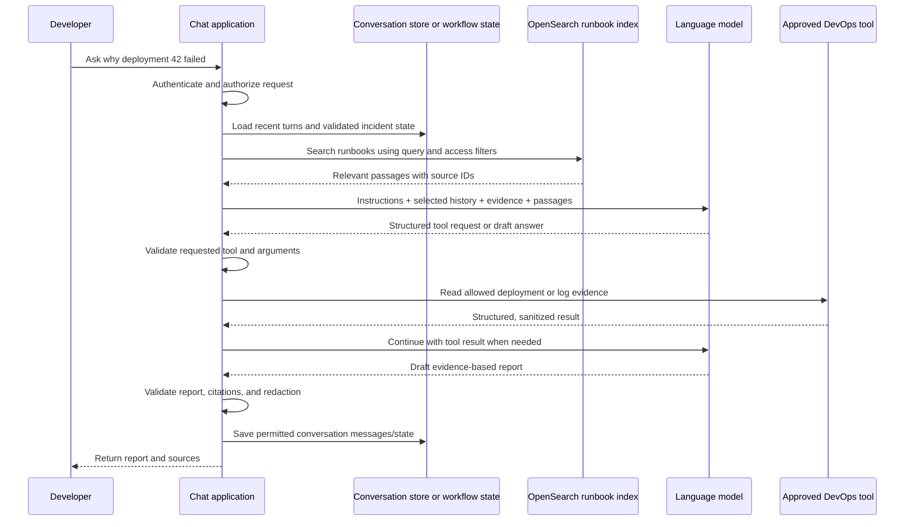

# Chat conversations, memory, chunks, embeddings, and OpenSearch

This note separates five ideas that are easy to mix together: **a conversation turn**, **the context sent to a model**, **application memory**, **document chunks**, and **vectors in OpenSearch**. They are related, but they are not the same thing.

## 1. What is a conversation turn?

A turn is one piece of conversation activity. Common message roles are:

- `user`: what the person says;
- `assistant`: what the model/application replies;
- `tool`: the result returned by an approved application tool.

For example:

```text
user: Why did orders-api deployment 42 fail?
assistant: I’ll check the deployment status first.
assistant/tool request: inspect_deployment(service="orders-api", revision="42")
tool: revision 42 is unhealthy; two tasks exited during startup.
assistant: The tasks exited during startup. I’ll inspect the sanitized startup logs.
user: This is the staging environment.
```

Some products call one user message plus its answer a turn. Tool calls can add more messages inside that interaction. For learning, think of a conversation as an ordered list of messages with roles, timestamps, and a conversation/session ID.

## 2. How can the chatbot answer a follow-up?

The language model usually receives a request containing instructions and context. It does not automatically know every message from a previous request. In a basic chat application, the application loads the relevant recent messages and sends them again with the new user message. Some provider APIs offer managed conversation state, but the same design questions remain: what is retained, for how long, and who can access it?

For example, if the user next says “What about the logs?”, that sentence is ambiguous by itself. The application includes enough recent context to connect it to deployment 42 and the staging environment. The model can then select an allowed log-inspection tool. If the application sends only “What about the logs?” with no history or incident state, the model may not know what service or environment the user means.

The model request can be pictured as:

```text
system instructions and safety rules
+ relevant recent conversation messages
+ validated incident state and tool results
+ retrieved runbook passages (when useful)
+ the newest user message
```

The application should send only context needed for this answer. A long chat may exceed the model’s context limit or include irrelevant and sensitive material, so the application may select, summarize, or omit old messages.

## 3. Chat history is not automatically a vector database

In the simplest chat design, turns are stored as ordered messages in application state or a database. For each new request, the app loads recent messages, builds the request context, calls the model, and saves the new user/assistant/tool messages. This is often enough for a short-lived support conversation.

Embedding every message into OpenSearch is **not** a required step in chatbot operation. OpenSearch is usually added when the system needs to search a larger knowledge collection—such as runbooks—or deliberately wants semantic search over selected long-term memories. Adding conversation history to a vector index changes the privacy, retention, and authorization requirements and should be a deliberate decision.

## 4. What are chunks and embeddings?

A **chunk** is a piece of a larger source document prepared for retrieval. A runbook might have a heading and several paragraphs explaining a Kubernetes probe failure. The ingestion process keeps that section together as a chunk and attaches source metadata.

An **embedding** is a numerical vector created by an embedding model from text. Similar meanings often produce nearby vectors, which allows semantic search. It does not turn text into a compact transcript that a person can read, and it does not guarantee that the model will understand every relationship in the conversation.

The common runbook RAG path is:

```text
approved runbook → parse → split into useful chunks → embed each chunk → index text, vector, and metadata
```

At question time, the application can embed the current question, search for similar chunk vectors, apply access filters, and add the selected passages to the model request. Keyword search can be combined with vector search to find exact strings such as `ExitCode=137`.

## 5. How OpenSearch fits into one chat request



The diagram shows two different kinds of state:

- The **conversation store/workflow state** tracks this active chat or investigation: recent messages, tool results, step limits, and status.
- The **OpenSearch runbook index** holds searchable knowledge passages. It is queried when useful; it does not have to store the live conversation.

In LangGraph terminology, a **checkpointer** saves state for one thread, such as the current conversation and an interrupted investigation. A **store** holds application-defined information across threads, such as a user preference or an approved historical incident summary. Either can be backed by a supported persistence implementation. Neither requires OpenSearch; a store can use a database or other storage and may optionally support semantic search.

The model is called with a selected context. The app validates tool requests before calling a tool and checks the final response before returning it. OpenSearch search results and logs are untrusted data, not instructions that can change the system’s policy.

## 6. When might conversation turns be embedded?

Use conversation-vector retrieval only if there is a clear product requirement—for example, an engineer explicitly asks, “Find the similar incident we investigated last month.” Even then, do not blindly embed every turn. A safer process is:

1. Decide which conversations are approved for reuse and tell users what is retained.
2. Remove secrets and unnecessary personal/customer data before indexing.
3. Create a useful memory unit, often a resolved-incident summary with the evidence, outcome, date, service, and source conversation ID. Keep enough context to interpret it; do not create a chunk containing only “Yes, that worked.”
4. Attach access metadata such as tenant/team, environment, classification, creation date, and retention deadline.
5. Store the source record under its normal access controls; keep a protected reference from the vector result to that source.
6. At retrieval, apply authorization filters before returning results. Expire or delete both the indexed memory and its source according to policy.
7. Evaluate whether the retrieved past incident is actually relevant and current. A similar symptom does not prove the same root cause.

For example, the app may save a reviewed summary: “Staging `orders-api` revision 42 failed at startup because its required configuration reference was absent; corrected by updating the task definition; verified by healthy tasks.” A future question about a similar startup failure may retrieve this summary. It should be labeled as a prior case, not treated as proof about the new deployment.

## 7. Three memory choices

| Need | Suitable starting approach | Example | Main trade-off |
|---|---|---|---|
| Understand a short current chat | Include a bounded window of recent messages | Keep the last several relevant exchanges about deployment 42 | Simple, but older context eventually falls out or uses more tokens |
| Keep a long chat understandable | Maintain a rolling summary plus recent messages | Summary: staging, revision 42, tasks exited; then append the latest three exchanges | Summary can omit a detail, so preserve source facts and refresh carefully |
| Find older conversations by meaning | Search approved incident summaries using embeddings, optionally with keyword search | Find past cases semantically similar to “container exits before readiness probe” | Adds ingestion, privacy/tenant filtering, index lifecycle, and retrieval evaluation |
| Keep exact operational facts | Store structured data in application state or a database | Current cluster, namespace, deployment ID, tool results, and investigation status | Requires schema/versioning and ordinary data access controls; vectors are not the source of truth |

These can be combined. For example, a live investigation can use structured workflow state, recent messages for conversational continuity, and OpenSearch for runbooks. Historical case retrieval can be added later if users need it.

## 8. Chunking conversations safely

If selected conversations are indexed, use meaningful units rather than arbitrary message fragments. A complete resolved incident summary is usually more useful than independent user and assistant messages because it preserves the symptom, evidence, outcome, and date together. For a longer case, chunk by investigation phase and keep a link to the parent case.

Store role/source, timestamps, conversation or case ID, tenant/team, environment, sensitivity, retention date, and review status as metadata where required. Metadata is not a substitute for authorization, but it enables the application to filter correctly. Do not put secrets, raw credentials, or unrestricted customer logs into embeddings. Treat the embedding and index as sensitive derived data because they can still reveal information about their source.

## 9. Practical example: one question, three inputs

Developer: “Was this the same issue we saw before?”

The application can use:

1. **Recent turns:** identify “this” as staging deployment `orders-api-42`.
2. **Current structured evidence:** the latest task exited at startup and a required configuration reference is absent.
3. **Retrieved context:** an approved runbook explains how to verify task-definition references; if historical incident search is enabled, a prior reviewed case may also be retrieved.

The response should distinguish these sources: “The current evidence shows a missing configuration reference. I found a prior staging case with a similar symptom, but that case is supporting context only. Verify the current task definition before concluding it is the same cause.”

## Security and design checklist

- Authenticate and authorize before loading conversation history or searching memory.
- Scope conversation IDs to the authenticated user/tenant; never let a caller guess another conversation ID and load it.
- Keep short-term workflow state, durable conversation records, runbooks, and historical vector memories logically distinct.
- Set retention and deletion behavior for messages, summaries, checkpoints, embeddings, and logs.
- Use tenant/team filters in the retrieval query itself, then validate result ownership before prompt construction.
- Limit how much history and retrieved text enter a prompt; redact secrets and escape content in rendered reports.
- Test that prompt injection inside an old message or retrieved case cannot expand tool permissions.
- Show provenance so a prior incident is clearly labeled as historical context, not current evidence.

## Interview questions

**Does the model remember the previous turn automatically?** Not necessarily. A typical application supplies relevant history on each request or uses an explicit provider-managed conversation feature. The application decides what is retained and shared.

**Does each chat message need to be chunked and embedded?** No. Recent history is commonly passed as messages or summarized. Chunking and embeddings are useful for semantic retrieval over a larger approved corpus, such as runbooks or selected historical cases.

**What is the difference between conversation state and RAG?** Conversation state supports continuity for an active interaction. RAG retrieves external knowledge for the current question. A system may use both, but they have different data, access, and retention rules.

**Can a vector search result prove that two incidents have the same root cause?** No. Similarity is a way to find potentially relevant cases. Verify the current incident against its own evidence.

## Official references

- [LangGraph persistence and threads](https://docs.langchain.com/oss/python/langgraph/persistence)
- [LangGraph memory concepts](https://docs.langchain.com/oss/python/concepts/memory)
- [AWS Prescriptive Guidance: RAG data lifecycle](https://docs.aws.amazon.com/prescriptive-guidance/latest/strategy-data-considerations-gen-ai/lifecycle.html)
- [Amazon OpenSearch vector search](https://docs.aws.amazon.com/opensearch-service/latest/developerguide/vector-search.html)
- [Amazon Bedrock data protection](https://docs.aws.amazon.com/bedrock/latest/userguide/data-protection.html)
