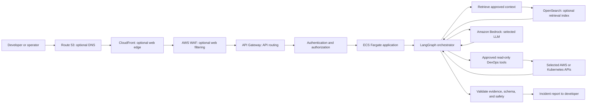
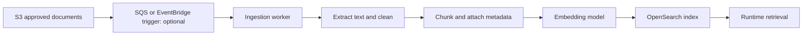

# 5. Agentic DevOps reference architecture

This is a teaching architecture for an incident-investigation assistant. It is not deployed infrastructure or a prescription to use every service. Start with requirements: users, data classification, response time, incident volume, permissions, availability, and cost.

## Request flow

The edge-to-API path depends on the interface and traffic. CloudFront is useful for a web UI and edge delivery; it is not required for a private internal tool. WAF can inspect supported web requests but does not replace application authorization. API Gateway handles API-facing concerns; it does not run LangGraph. ECS Fargate runs containers without requiring the customer to manage EC2 hosts. LangGraph controls workflow state and routing. OpenSearch serves retrieval only if the use case needs a search index. Bedrock provides model inference; it is separate from the orchestrator and search layer.

## Knowledge ingestion flow

For a small curated set, ingestion can be a controlled batch job instead of an event-driven system. SQS is useful for buffering and retrying jobs; EventBridge routes events. Choose based on delivery, ordering, retry, and fan-out requirements. Version source documents, chunking configuration, embedding model, and index schema so re-indexing is controlled.

## Component boundaries

1. **AWS networking** decides which resources can connect, over which routes, and with which security controls.
2. **API routing and identity** receive requests, authenticate the caller, authorize the requested scope, and enforce request limits.
3. **Application/runtime** validates incident input and coordinates work. LangGraph is the agent workflow layer inside application code.
4. **Retrieval** finds authorized runbook passages and returns provenance. It is not the LLM.
5. **Model inference** produces structured tool proposals or natural-language output. A server-side validator decides whether a proposal can be executed.
6. **Tool layer** performs explicit, typed, scoped reads and records results. It is the boundary to operational systems.
7. **Response validation** checks schema, citations, secret redaction, and policy before showing a report.

## Key design decisions

- A synchronous API is suitable for a short investigation that fits a request deadline. Return a job ID and run asynchronously if the flow can exceed gateway/application timeouts, needs queues, or must survive long waits.
- Keep the agent service in private subnets when it does not need inbound internet access. Private placement alone does not stop outbound access; routes, endpoints, security groups, DNS, and IAM still matter.
- Use a Bedrock interface VPC endpoint when private connectivity is required and supported for the selected service/region. This is distinct from model orchestration and may involve endpoint costs.
- Separate read tools from any later write tools. Use a different role or execution path for writes, require approval, revalidate state just before execution, and record the actor and result.
- OpenSearch is one retrieval choice, not a default requirement. A small corpus may be served from files or a simpler search service; relational data may fit PostgreSQL, and pgvector is an alternative where it meets retrieval and scale needs.

## Security and production considerations

Authenticate users and authorize both incidents and documents. Apply tenant filters before retrieval, not just after generation. Treat logs and documents as hostile text. Never execute model-generated shell commands. Limit tool resources and call counts, redact secrets, encrypt data, and audit access. Define checkpoint/log retention because they can contain incident details. Test prompt injection and cross-tenant leakage. Provide a deterministic fallback report when the model or retrieval system is unavailable.

## Trade-offs and questions

Managed services reduce some operational burden but create service-specific limits, costs, and dependencies. Private endpoints can reduce public network exposure but do not replace IAM or application authorization. More services can improve isolation or scaling but also add failure modes and cost.

**Why use both API Gateway and an ALB?** Only when their distinct needs justify both. API Gateway offers API-level routing/features; an ALB routes HTTP traffic to targets such as ECS. A simpler service may need only one ingress layer.

**Does the architecture require OpenSearch?** No. Use it when an indexed retrieval workload needs its capabilities. It is not necessary for LangGraph or model inference.

## Official references

- [Amazon API Gateway](https://docs.aws.amazon.com/apigateway/latest/developerguide/welcome.html)
- [API Gateway private integration for HTTP APIs](https://docs.aws.amazon.com/apigateway/latest/developerguide/http-api-private-integration.html)
- [Amazon ECS](https://docs.aws.amazon.com/AmazonECS/latest/developerguide/Welcome.html)
- [Amazon Bedrock VPC endpoints](https://docs.aws.amazon.com/bedrock/latest/userguide/vpc-interface-endpoints.html)
- [OpenSearch vector search](https://docs.aws.amazon.com/opensearch-service/latest/developerguide/vector-search.html)
