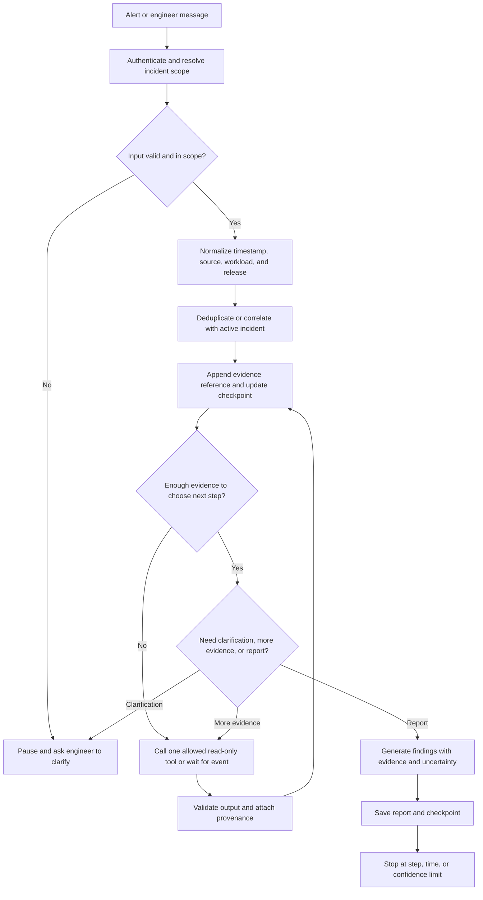

# Optional Advanced Lesson: Stateful Incident Investigation

In the core series, we build an investigator that receives an incident, gathers evidence, and writes a report. Real incidents do not always arrive as one complete request. A deployment event may appear first, logs may arrive a few seconds later, and an engineer may ask a follow-up question after reading the first report.

This lesson extends the same read-only DevOps investigator so it can handle new evidence and follow-up questions without losing the incident context. The examples here are synthetic and written for this learning project.

## What we are building

Imagine the `orders-api` deployment begins restarting containers after a release. The investigator receives an alert, reads approved status and log tools, and reports that the process exits because a required environment variable is missing. A few minutes later, a new deployment event arrives. The engineer asks, “What changed in the last release?”

The investigator should connect that question to the active incident, compare the new release evidence with the current findings, and show its sources. It should not treat every event or conversation turn as a new incident, and it should not invent a change when the evidence is unavailable.

## Four different kinds of state

People often call all retained information “memory,” but these pieces have different jobs:

| Information | Example | What it is for |
|---|---|---|
| Conversation turns | Engineer asks, “What changed in the last release?” | Understand the current exchange and resolve references such as “that deployment.” |
| Workflow state or checkpoint | Incident ID, confirmed findings, tools already called, remaining step budget | Resume the investigation safely after a pause or new event. |
| Events and log windows | Deployment version, pod restart event, time-bounded application logs | Establish what happened, in what order, and which workload it concerns. |
| RAG document chunks | A paragraph from an approved Kubernetes or service runbook | Find durable instructions and explain recommendations with citations. |

The conversation is not automatically a vector index. Workflow state is not a substitute for the original evidence. Event records should retain their time and source. RAG chunks represent documents prepared for semantic search; they are not a safe default storage format for every log line or chat message. See [Conversation, memory, and retrieval](../03-rag/conversation-memory.md) for the request-time distinction.

## Investigation flow

The system processes each incoming event or engineer message against a scoped investigation. It validates the source and incident scope, preserves evidence provenance, updates state, then decides whether to gather evidence, ask a question, report, or stop.



### What each step means

1. **Authenticate and scope the input.** Resolve the alert to a known service, environment, and incident ID. Do not let a text field from an event choose a different account, cluster, or tenant.
2. **Normalize while keeping the original.** Convert timestamps to one standard for comparisons and keep the received value, source, and event ID for audit. Redact secrets before anything reaches a model or report.
3. **Correlate conservatively.** Use explicit keys such as incident ID, deployment ID, service, environment, and a bounded time window. If two events cannot be linked confidently, keep them separate or ask an engineer.
4. **Update a small checkpoint.** Store what the workflow needs to resume: scope, evidence references, confirmed and rejected hypotheses, actions already attempted, and the remaining budget. Keep full source records in their governed evidence store.
5. **Choose one bounded next action.** The workflow can call an allowlisted read-only tool, search approved runbooks, request clarification, wait for more events, or finish. It should never have an unbounded “keep thinking” loop.
6. **Report with traceable evidence.** Each finding should point to the source and time that support it. Mark missing evidence and uncertainty instead of filling gaps with a guess.

## Follow-up conversation example

The first investigation turn finds a restart loop and saves a checkpoint:

```json
{
  "incident_id": "inc-demo-042",
  "scope": { "service": "orders-api", "environment": "staging" },
  "findings": ["container restarted 6 times between 10:14 and 10:19 UTC"],
  "evidence_refs": ["event-demo-17", "logs-demo-22"],
  "hypotheses": ["startup configuration may be incomplete"],
  "tool_calls_remaining": 3,
  "status": "awaiting_follow_up"
}
```

Then the engineer asks: “What changed in the last release?” The application resolves “the last release” against the incident scope and requests an approved deployment-history lookup for `orders-api` in staging. If that tool returns release `2026.10.12.3` and its changed configuration list, the agent can compare it with the restart evidence and cite both sources. If deployment history is not available, it should say that the release change is unverified and ask the engineer to provide the deployment record.

The current thread history may help interpret the question. The checkpoint directs the workflow. The deployment record supplies evidence. A runbook search can explain how to validate a missing setting. Those roles should stay explicit.

## Event windows and document chunks are different

For a large stream of logs or events, a collector may read a bounded window—for example, one workload over a five-minute interval. The window is a retrieval or processing boundary. It should preserve event order, timestamps, source identifiers, and correlation metadata. It may be summarized for the investigation, but the summary should link back to the source records.

RAG chunking is different: it splits relatively stable knowledge documents such as a runbook into searchable passages. A document chunk needs a document ID, title, version, and access scope. A log window needs time bounds and workload scope. Treating both as generic text chunks makes it harder to answer “what happened before the restart?” or to prove where a recommendation came from.

Do not embed every chat turn or log line by default. Use the active conversation and checkpoint for the current investigation. Search the runbook index for durable guidance. Add a separate historical-incident index only when there is a clear use case, a retention policy, access controls, and a way to remove sensitive data.

## Failure handling and safety limits

- Reject events with an unknown service, malformed timestamp, or untrusted scope rather than silently broadening access.
- Treat log text, ticket descriptions, and retrieved documents as untrusted data. They may contain instructions; they cannot grant tools or permissions.
- Bound the number of tool calls, investigation duration, event-window size, and retained conversation history.
- Handle duplicate and out-of-order events with event IDs and timestamps. Make state updates idempotent so retries do not create duplicate findings.
- Pause when the environment or incident identity is ambiguous, evidence sources conflict, required data is missing, or a remediation is requested.
- Keep the agent read-only in this lesson. If a later lesson proposes remediation, present the exact target and change, require an authorized human approval, and revalidate before execution.
- Record tool names, input scope, timestamps, evidence references, and outcomes. Redact credentials and sensitive values from logs.

## Learner exercise

Use a synthetic restart incident and add three updates: a duplicate restart event, a deployment event that arrives late, and an engineer follow-up asking what changed. Design the correlation rules, update the checkpoint, and produce a report that distinguishes observed facts from hypotheses.

Add evaluation cases for a valid follow-up, a question about the wrong environment, an event with a mismatched service, a prompt-injection string inside logs, and missing deployment history. The expected result should specify tool calls, evidence references, whether the system asks a question, and whether it stops. Keep fixtures fake and tests deterministic; connect the cases to the [Day 8 evaluation goal](../ROADMAP.md).

## Architecture options

For a local lab, a Python process can read a JSON fixture, keep an in-memory checkpoint, and process the next event on demand. This is enough to teach the state transitions.

At larger scale, an event bus or queue can buffer incoming events, a worker can update a durable checkpoint, and an API can serve engineer follow-ups. A graph workflow can pause and resume by investigation ID. A document index can serve runbook search. These are separable roles: learners should add a queue, database, vector search service, or managed model only when a requirement justifies its operational cost.

## Further reading

- [LangGraph persistence](https://docs.langchain.com/oss/python/langgraph/persistence) explains checkpointing and resuming graph state.
- [LangGraph interrupts](https://docs.langchain.com/oss/python/langgraph/interrupts) explains pausing a workflow for human input.
- [OpenTelemetry logs data model](https://opentelemetry.io/docs/specs/otel/logs/data-model/) describes common fields for log records.
- [Amazon SQS visibility timeout](https://docs.aws.amazon.com/AWSSimpleQueueService/latest/SQSDeveloperGuide/working-with-visibility-timeouts.html) is one example of queue delivery behavior to consider if the optional AWS architecture is implemented.

These references explain building blocks; they do not imply that this lab deploys or requires those services.
