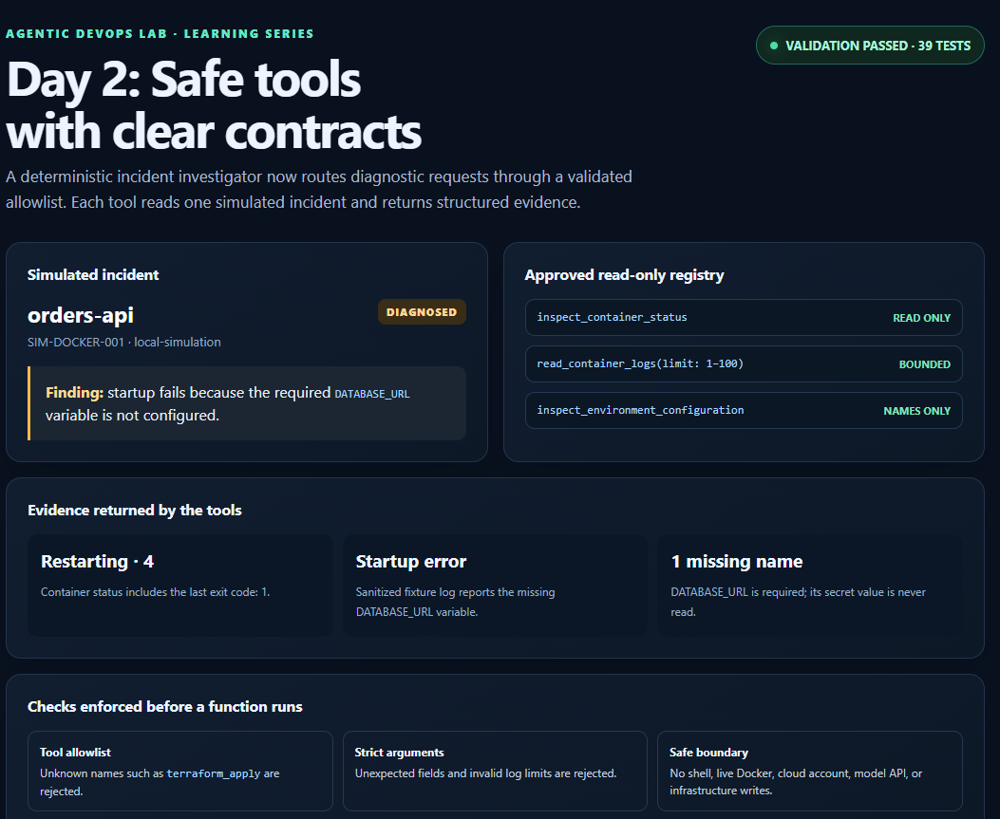

# Day 2: Give the investigator safe tools

On Day 1, the investigator called three Python functions directly. Today, we put a small registry between the investigation and those functions. The registry is the application's allowlist: it describes which tools exist, checks each request, and only then calls the matching function.

The tools still read the same simulated incident fixture. They do not connect to Docker, AWS, the network, or a model. On Day 3, a local evidence-based selector will choose among these tools so we can inspect the investigation loop before introducing model-selected choices in a later lesson.

## What is a tool schema?

A schema tells the caller the tool's name, purpose, accepted inputs, and input types. The schema below says that `read_container_logs` accepts an optional integer named `limit` from 1 to 100:

```json
{
  "name": "read_container_logs",
  "description": "Read a bounded number of sanitized startup log entries from the fixture.",
  "parameters": {
    "type": "object",
    "properties": {
      "limit": {
        "type": "integer",
        "minimum": 1,
        "maximum": 100
      }
    },
    "required": [],
    "additionalProperties": false
  }
}
```

The schema is a contract, not a security boundary by itself. A model or other caller can still send invalid data. Our Python registry checks the name and arguments again before invoking a function.

## How a request is handled

```text
requested tool name + JSON arguments
                 |
                 v
       Is the name allowlisted?
          /             \
        no               yes
        |                 |
      reject       Is the input an object?
                       /       \
                     no         yes
                     |           |
                  reject   Are all fields valid?
                               /       \
                             no         yes
                             |           |
                          reject   run fixture-only function
```

For example, `{"limit": 2}` is accepted. `{"limit": 0}`, `{"limit": true}`, and `{"command": "docker ps"}` are rejected. Booleans need a special check in Python because `bool` is a subtype of `int`.

## Why bind tools to a validated incident?

The registry receives one validated `Incident` when it is created. A tool request can choose an approved diagnostic operation and, where appropriate, a bounded option such as the log limit. It cannot choose an arbitrary file path, shell command, AWS account, or cluster. This lab has no live connectors to choose from.

The three tools return structured `DiagnosticEvidence`: a tool name, a short summary, details, and a source label. The configuration tool compares variable names only. The log reader redacts common secret formats and caps the number of entries returned through the registry.

## Try it

From the repository root, install the project and development dependency once:

```powershell
python -m pip install -e ".[dev]"
```

Then run the tests and the deterministic example:

```powershell
python -m pytest
python examples/investigate_incident.py
```

`src/agentic_devops/registry.py` contains the allowlist and validation. `tests/test_registry.py` checks unknown tools, unexpected fields, invalid limits, and structured tool descriptions. The investigation now uses the registry, so this is part of the working path rather than a disconnected demo.

## Visual reference

The [Day 2 registry demo](evidence/day-2-tool-registry.html) shows the simulated finding, the three approved tools, and the validation checks. Here is the screenshot captured from the demo page:



## What we have not added yet

There is no model deciding which tool to call. There are no shell commands and no write tools. On Day 3, a local evidence-based selector will choose the next approved tool so we can understand and test the investigation loop before introducing a model. Any future model suggestion must still pass through this same application-side registry; the model never gets direct execution access.
