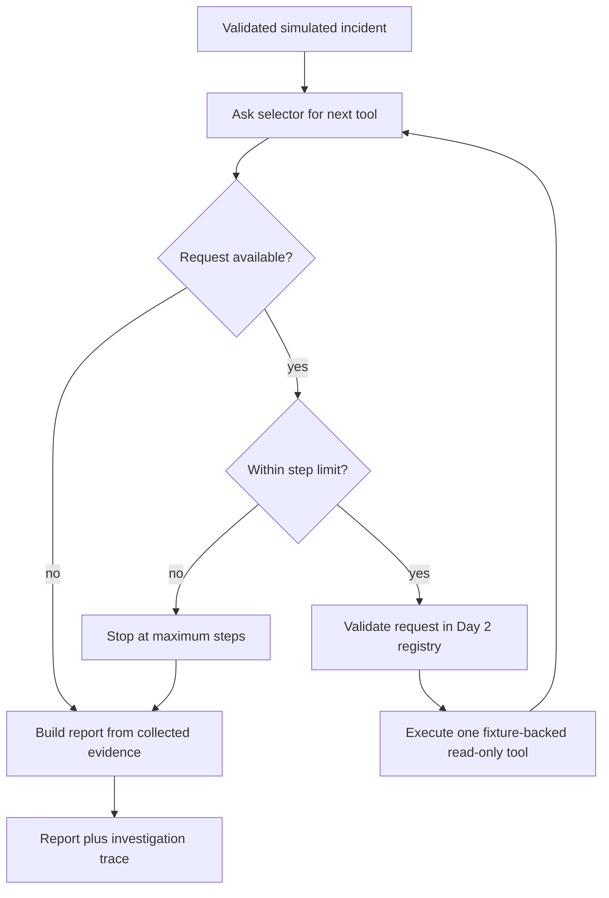

# Day 3: Build a bounded investigation loop

On Day 1, our program followed a fixed sequence. On Day 2, we added a registry that validates every tool request. Today, we connect those ideas: the investigator looks at the evidence it has collected, chooses the next useful approved tool, and stops when it has enough evidence or reaches a limit.

We are deliberately using a small local selector today. It makes the decision rules visible and keeps the lesson deterministic: no API key, model call, cloud account, or network connection is needed. A future model-backed selector can implement the same interface, but the tool registry remains the enforcement boundary.

## The loop



The selector does not receive a shell or a live Docker/AWS connection. It can only ask for a tool name and JSON arguments. The registry checks that request, runs an approved fixture-only function, and returns structured evidence. The loop records why the selector asked for each tool and what summary came back.

## Follow one incident

Run this from the repository root after installing the local package:

```powershell
python -m pip install -e ".[dev]"
python examples/investigate_with_loop.py
```

For the `orders-api` fixture, the trace is:

1. Inspect container status. The status reports four restarts, so the investigator looks for a startup error.
2. Read up to 20 sanitized log entries. The error mentions a missing `DATABASE_URL`, so the investigator checks configuration.
3. Inspect required and configured variable names. This confirms that `DATABASE_URL` is required but not configured. Values are never read.
4. The loop has used its three-step budget, so it stops without requesting a fourth action and reports a diagnosis backed by the collected status, log, and configuration evidence. Reaching the cap is recorded as `max_steps_reached`; it does not invalidate a diagnosis whose required evidence is present.

The steps are chosen using evidence. If the first status check shows a healthy running container with no restarts, the local selector stops without reading logs or configuration. If the loop reaches its maximum, it reports only what the evidence supports; an incomplete trace must not be described as a confirmed root cause.

## Inspect the implementation

- `src/agentic_devops/loop.py` contains `ToolRequest`, the selector interface, the local evidence-based policy, step records, and the bounded loop.
- `src/agentic_devops/registry.py` remains the only way a selector can execute a tool.
- `src/agentic_devops/investigation.py` creates a finding from the evidence actually collected. The Day 1 `investigate()` function remains available as the fixed baseline.
- `examples/investigate_with_loop.py` prints the decision trace and final report.
- `tests/test_loop.py` verifies the order, stop behavior, step limit, partial-evidence behavior, and rejection of an unapproved tool.

The hard maximum is three steps because the current registry has three distinct tools. Repeating an already-run tool ends the loop. Invalid names or arguments are rejected by the registry, and they never become shell commands. This keeps the example small enough to follow while demonstrating the control points a production agent needs.

## What this is—and is not

This is an agent-style investigation loop with explicit, local decision rules. It demonstrates the control flow, but it is not an LLM reasoning demo: the selector's policy is ordinary Python so learners can inspect exactly why each action happened. We will compare this transparent baseline with orchestration and optional model-backed decisions in later lessons. Tests and CI can continue to run without paid model calls.

## Run the checks

```powershell
python -m pytest
python examples/investigate_with_loop.py
```

All input remains synthetic. No resources are created or changed, and the investigator recommends checks rather than applying a fix.
