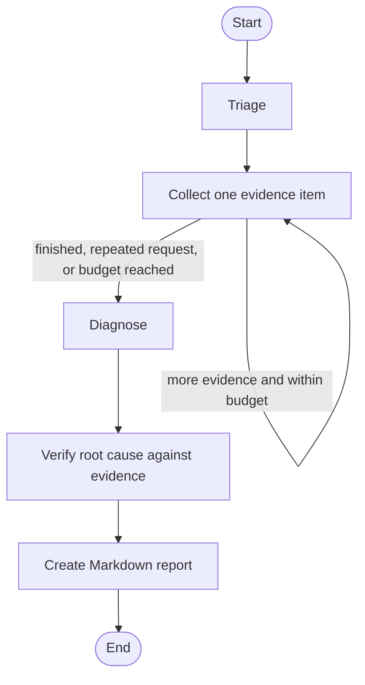

# Day 4: Orchestrate the investigation with LangGraph

Day 3 gave us an evidence-based investigation loop. Today we make its workflow visible and easier to extend by representing it as a LangGraph `StateGraph`.

LangGraph is the workflow runtime. It stores the investigation state, runs named nodes, and follows normal or conditional edges. It does not provide a language model by itself, and this lab does not make a model API call.

## What we are building



The graph has five named nodes:

| Node | Responsibility |
|---|---|
| `triage` | Validate the synthetic incident and record the reported service symptom. |
| `collect_evidence` | Ask the local selector for one next check, pass it through the Day 2 tool registry, and append its structured result. |
| `diagnosis` | Apply the existing evidence rules to what the graph actually collected. |
| `verification` | Independently check that a diagnosis is backed by the status, log, and configuration evidence. |
| `report` | Render the verified result as a readable Markdown report. |

## State, nodes, and edges

The `InvestigationState` in `src/agentic_devops/orchestration.py` carries the validated incident data, triage summary, evidence, executed steps, stop reason, diagnosis, verification result, and final report. State values are kept JSON-friendly so they can be checkpointed.

Each node is a Python function that reads the current state and returns only the fields it updates. The normal edges connect triage to evidence collection, diagnosis to verification, and verification to reporting. A conditional edge after evidence collection either loops back for one more check or routes to diagnosis. This is the same decision flow from Day 3, now made visible in a graph.

## Checkpoints and thread IDs

The graph is compiled with LangGraph's `InMemorySaver`. During one local run, LangGraph saves state at graph boundaries and lets the example inspect the final checkpoint with `get_state`. Each run uses a thread ID to identify its state.

This checkpointer is for learning only: its data disappears when the process exits and its state is not protected for production use. Real incident data should only be checkpointed with a secured persistence layer, access controls, encryption, and an explicit retention policy. Keep this repository's fixtures synthetic.

## Bounded steps and retries

The graph can execute at most three distinct diagnostic tool calls because the current allowlist contains three checks. After that, it goes to diagnosis. LangGraph also receives a recursion limit of 16 supersteps as a second bound on the complete workflow.

Only the evidence-collection node has a retry policy, and it retries only `ConnectionError` once. This illustrates how to retry a transient failure without retrying invalid tool names, invalid arguments, or other programming errors. The current fixture tools do not call a network, so the retry is demonstrated by a local test that injects a one-time connection failure. In a live system, retries must fit within the overall deadline and must be safe for the operation being retried.

## Run it

Install the project dependencies, then run the example and tests from the repository root:

```powershell
python -m pip install -e ".[dev]"
python examples/investigate_with_langgraph.py
python -m pytest
```

The example streams the node names as LangGraph executes them, then prints the checkpointed stop reason, verification result, number of tool calls, and final report. The `orders-api` scenario should visit `triage`, `collect_evidence` three times, `diagnosis`, `verification`, and `report`.

## Inspect and test

- `src/agentic_devops/orchestration.py` defines the state, node functions, conditional route, read-only tool boundary, bounded retry policy, and in-memory checkpointer.
- `examples/investigate_with_langgraph.py` runs and displays the graph execution.
- `tests/test_orchestration.py` checks node order, branching, checkpoints, diagnosis verification, the tool-step bound, retry filtering, and rejection of an unsafe tool request.

LangGraph gives us a clear place to add later steps such as runbook retrieval or a model-backed selector. Today the decisions remain deterministic, and the graph cannot change containers or infrastructure.
