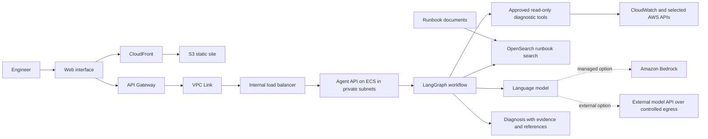
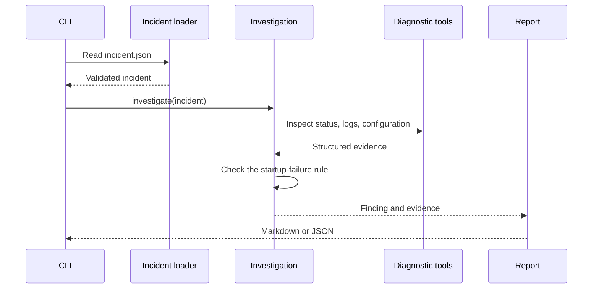

# Day 1: how the investigator works

## The destination: an agentic DevOps service

Before looking at code, it helps to see how the ideas fit together. An incident starts an investigation. The workflow gathers operational evidence through approved tools, searches runbooks for relevant guidance, and prepares a report for an engineer.

CloudFront can serve the web files. API Gateway is the public API entry point, while VPC Link and an internal load balancer can connect it to a service that stays in private subnets. ECS runs the agent API. These are deployment choices; the same investigation logic can first run as a local command.

LangGraph coordinates steps and carries investigation state. It is not the model. RAG (retrieval-augmented generation) means searching our selected runbooks and supplying relevant passages as context to the model. OpenSearch is one possible place to index and search those passages. The model helps interpret the evidence and compose a response; approved tools provide the operational facts.

Model choice is a practical trade-off: can it follow tool instructions reliably, handle the context we need, meet our response-time and privacy needs, and fit the budget? For semantic RAG search, an embedding model converts text into vectors; a generative model uses the retrieved passages and incident evidence to produce an answer. They can be separate models.

We’ll use this diagram as a map, then build the pieces in order. The complete AWS service is not deployed in Day 1. LangGraph is introduced on Day 4, runbook retrieval on Day 5, and optional AWS evidence checks on Day 7. CloudFront, API Gateway, VPC Link, the load balancer, ECS, and OpenSearch remain architecture concepts until a later implementation calls for them.

## The Day 1 local flow

Our sample incident says the `orders-api` container keeps restarting. The application logs report that `DATABASE_URL` is missing, and the configuration checklist confirms the variable is required but not set.

The Day 1 program reads that incident from a local JSON file. It checks the data, runs three small diagnostic functions, and compares the evidence with one known startup-failure rule. It then writes a Markdown or JSON report.

## What each tool checks

- `inspect_container_status` reports the simulated state, restart count, and exit code.
- `read_container_logs` reports the supplied startup messages and redacts common secret assignments.
- `inspect_environment_configuration` compares required and configured variable **names**. It never reads values.

The investigation receives a validated `Incident` object. It does not accept shell commands, a Docker client, an AWS client, or a network connection. The CLI reads the selected fixture; the tools themselves only inspect its in-memory data.

## Why the expected answer is separate

The expected finding is only for the tests. The investigation function does not load it. That lets us check whether the program reached the right conclusion from its evidence instead of simply repeating the answer.

Day 1 uses a fixed rule and known input so we can see the expected evidence and report. There is no model call or agent loop yet. We’ll add those in later lessons and compare their output against this baseline.
