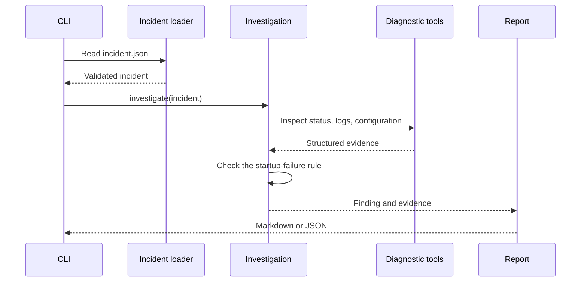

# Day 1: how the investigator works

Our sample incident says the `orders-api` container keeps restarting. The application logs report that `DATABASE_URL` is missing, and the configuration checklist confirms the variable is required but not set.

The Day 1 program reads that incident from a local JSON file. It checks the data, runs three small diagnostic functions, and compares the evidence with one known startup-failure rule. It then writes a Markdown or JSON report.

## What each tool checks

- `inspect_container_status` reports the simulated state, restart count, and exit code.
- `read_container_logs` reports the supplied startup messages and redacts common secret assignments.
- `inspect_environment_configuration` compares required and configured variable **names**. It never reads values.

The investigation receives a validated `Incident` object. It does not accept shell commands, a Docker client, an AWS client, or a network connection. The CLI reads the selected fixture; the tools themselves only inspect its in-memory data.

## Why the expected answer is separate

The expected finding is only for the tests. The investigation function does not load it. That lets us check whether the program reached the right conclusion from its evidence instead of simply repeating the answer.

Day 1 uses a fixed rule and known input so we can see the expected evidence and report. There is no model call or agent loop yet. We’ll add those in later lessons and compare their output against this baseline.
